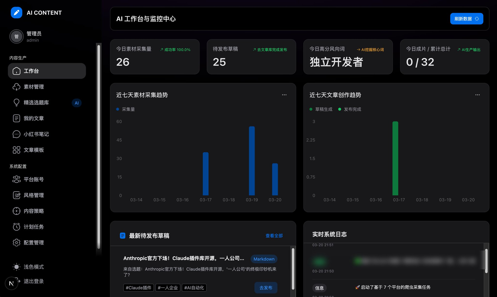
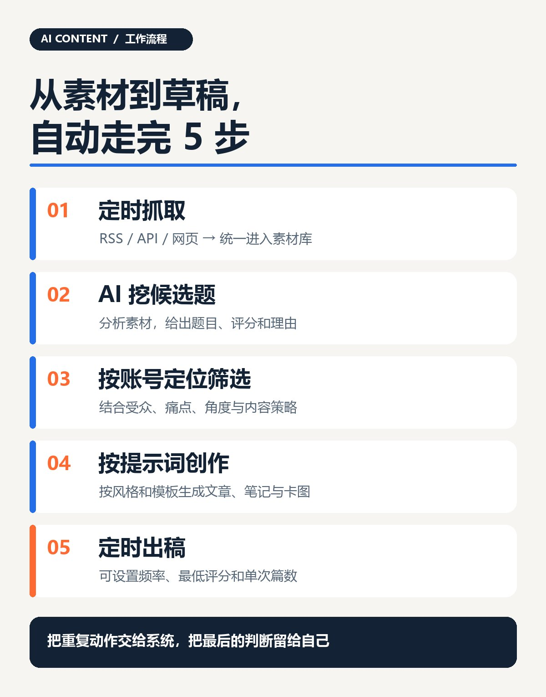
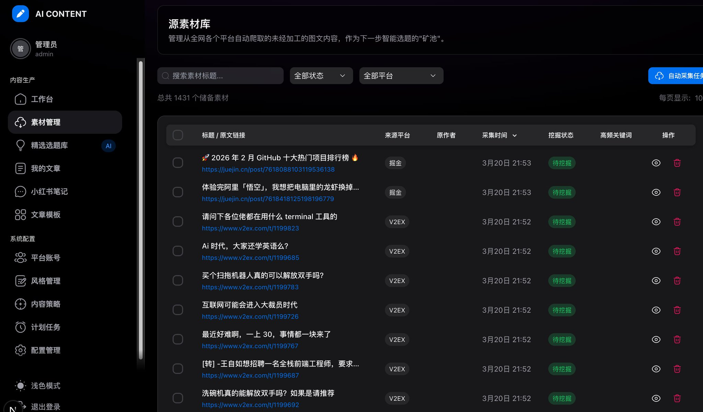
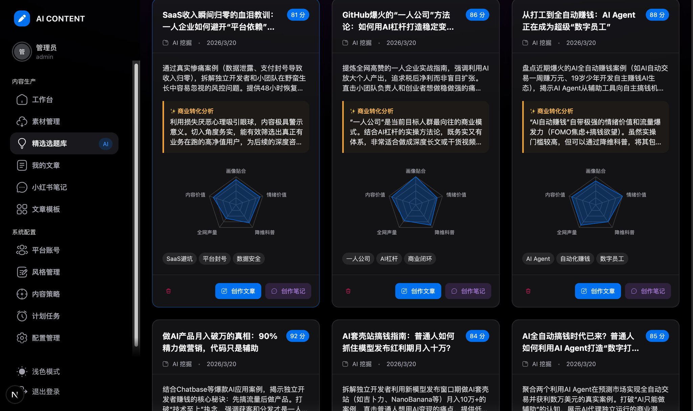
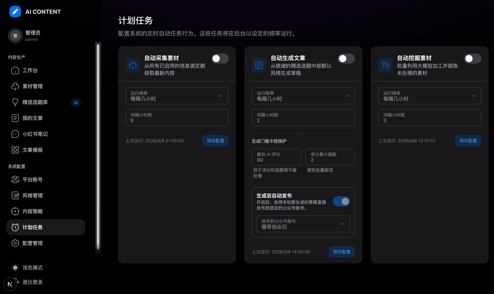

# 我做了个会定时抓素材、挖选题、写文章的 AI 系统

你们有没有发现，做内容最消耗的，往往不是写稿那一小时。

是每天打开一堆网站找素材，猜哪个话题值得写，再把账号定位、写作要求重新讲给 AI。一天结束，真正用来表达自己判断的时间反而不多。大部分时间都消耗在收集话题上面了。这完全是可以避免的。

所以我给自己做了个系统，叫**AI Content**。

它会按计划抓取信息源，AI 从素材里分析候选选题、给评分和理由，结合你预设的账号定位与内容策略筛选，再按提示词、风格和模板生成文章或小红书笔记。

抓取、挖题、出稿都能定时跑。里面内置了很多的信源渠道，很方便就可以抓取到适合我的话题方向。

我想要的结果很直接，打开工作台时，面前已经有一批带来源的素材、值得考虑的选题和可修改的初稿。每天只用去审核，找到一些合适的选题即可。

代码已经放在 GitHub，目前已经有200star。下面用真实界面，把这条链路讲清楚。

## 为什么我要自己做一套

因为做自媒体，难免要去找一些爆款选题，但是这些又非常的耗时间，总不能说把所有的时间都耗在这个选取选题上。前期的话是可以这样的，慢慢的去培养自己的网感，但是随着时间的推移，这个事情越来越不值得做了。所以说呢，就想着自己去把这个重复的事情去给它用AI完成。

在实际的过程中最烦的不是某篇文章难写，而是整套流程每天都要从头来，刷信息、存链接、整理素材、想角度、写提示词、起初稿。太多时间都浪费在了刷信息上面。而且这个完全是机械的，重复的，明明可以用AI来替代的。

我把这些重复动作拆开，做成了一个可以配置、可以定时执行的工作台。它替我跑流程，我把时间留给选题判断、事实核验和最后的表达。

## 它究竟怎么跑？

一句话概括，**定时抓取 → AI 分析选题 → 按账号定位筛选 → 按提示词创作 → 定时出稿。**

比如你做一个面向独立开发者的 AI 工具账号，先配好常看的资讯源和**读者定位（定位很重要，会直接影响系统给你的选题）**。系统按你设的时间收素材，AI 从中提炼候选题、给出评分与理由，再围绕定位筛选，按你的提示词和文章模板生成草稿。你打开后台时，面对的是一批可以审核的选题和初稿。

下面拆开说。这个顺序也是我自己实际用它的顺序。

## \1.定时抓素材，不用每天手动刷

先配好你长期关注的信息源。系统支持 RSS、API 和网页抓取，按计划把内容收到同一个素材库，留下来源、原文链接和采集时间。

过去我看到一个链接，先收藏，过两天想写，已经不知道它躺在哪个平台。现在素材会进同一个入口，还能看到哪些已经处理、哪些待挖掘。

信息源要自己选。你喂给它什么，决定它后面能挖出什么。系统能持续收集，但不会凭空把低质量来源变成好选题。

## \2.AI 分析素材，挖有传播潜力的选题

素材进来后，AI 会提炼候选题，给出评分和理由。你不用再盯着一堆原文链接，从零想今天写什么。

我希望它找的是两类交集，**读者愿意看且有爆款潜力**，以及**适合我这个账号写**。

这里就很重要一点，比如从不同信源抓取了很多选题，其中有些选题肯定是重复的，系统会自动整合这些相似的选题，从5个维度来进行评分。详细如图琐事。

截图里有些题目很猛，评分也高。它们很像爆款选题，但评分只是筛选线索。最后还是要看来源能否核验、角度有没有自己的经验、标题会不会把话说过头。

这一步最大的价值，是把翻素材找角度变成审一批已经分析过的候选题。简单的讲就是不需要自己去扒了，二十变成了审核。

## \3.根据账号定位筛选选题

同一个热点，做 AI 工具的号、做副业的号、做品牌营销的号，切入点完全不同。系统会自动去整理这些信源的角度，把他们的想法融入进去。

所以系统里可以先设内容策略，写给谁、他们在意什么、想从哪个角度切、用什么语气。挖题与评分围着这些条件走，定时生成还能设置最低评分，让明显不合适的题先停在选题库。

这个也是一个评分机制，所以前面写的，定位一定要写准，这个是很重要的，写的越准，你最后的话题匹配度也会越高。

## \4.按你的提示词、风格和模板出稿

确定方向后，再调用你配置的模型、提示词、风格和文章模板出稿。它支持文章的 Markdown、HTML 模板，也能做小红书笔记和卡图。（**小红书的是一个卡片风格，下载可以自己去做不同风格的卡片**）

你的定位、素材来源、选题和创作要求，在同一条链上。系统会带着这些信息生成初稿。

初稿出来后，我会删套话、补自己的案例、核对事实。尤其是涉及收入、效果、产品能力的句子，我会重新看一遍。

然后没问题的，可以复制到公众号里面进行发布，也可以直接通过接口存入到公众号草稿中。

## \5.计划任务

采集、挖掘、生成都可以设运行频率。比如让系统隔几个小时收一次素材，再从达到评分门槛的选题里生成有限篇数的草稿。

截图里，我给自动生成设了最低 90 分、单次最多 2 篇。它避免系统一口气堆出几十篇等我审核的稿子。

目前代码里的自动发布对接的是微信公众号。其实这个发布，也只是推送到草稿箱，最终的发布动作也是由人工来完成。

## 到底省了什么时间？

我没有给它编一个效率提升 10 倍的数字。每个人的信息源、模型、审核标准都不同，节省多少得自己跑一阵才知道。

但对我来说，变化很具体。

- 多个平台的内容会按计划进入同一个素材库
- AI 先把候选题、评分和理由整理出来
- 账号定位、风格和模板不用每次从头交代
- 定时生成把“从空白页开始”变成“审核并修改初稿”

我把重复的收集与起稿交给系统，自己集中做判断和表达。这才是我做 AI Content 的原因。

## 想试的话，从一条流程开始

它需要自行部署，数据库、Redis，以及一个兼容 OpenAI 接口的模型服务。仓库里有安装与首次配置说明。

> **这个系统开发好有不少朋友想要使用，但是其实并不是每个人都和我做一样的领域，又很难去做成一个通用的东西。所以说呢，最好的方式就是把它开源，每个人根据自己的情况去匹配，选择合适的信源。而且也可以不断地去二次升级改造，让整个系统更加适合你**

第一次用，建议只配一个可靠的信息源、一套内容策略和一种写作风格。先跑通“素材 → 选题 → 初稿”，再逐步打开计划任务。

项目在这里：[https://github.com/CheeMao/ai-content](https://github.com/CheeMao/ai-content)

另外，我还准备公开一个基于 Remotion 的动画制作项目。下一篇我会直接拿实际成片和制作过程出来，聊聊内容怎么从文字走到动画。

我是猫哥，一个野生的程序员，之前运营2000多个公众账号，擅长矩阵，做内容项目，也用 AI 和代码把重复工作自动化。
